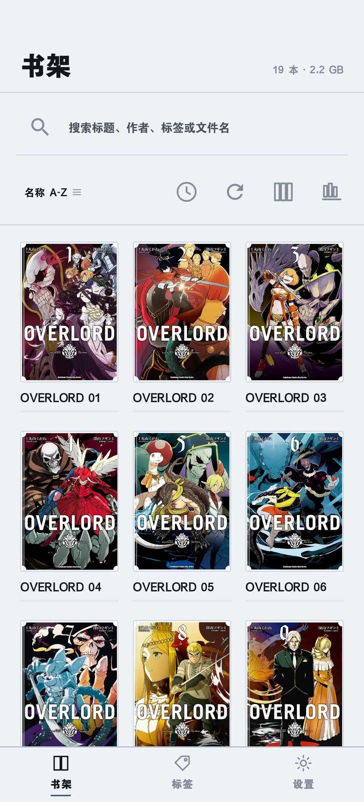
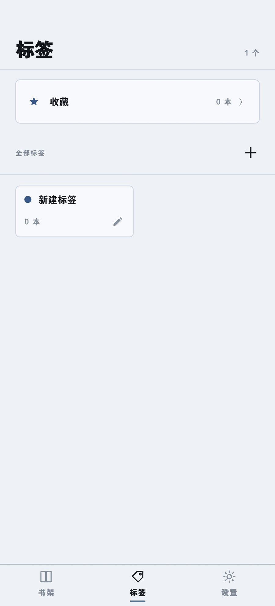

<div align="center">

# Gaze


### 支持标签体系的简洁、轻量本地 Android 漫画阅读器


[下载](https://github.com/CyanRiverX/Gaze/releases) · [更新日志](https://github.com/CyanRiverX/Gaze/releases) · [问题反馈](https://github.com/CyanRiverX/Gaze/issues)

</div>

---

## 项目简介

Gaze 是一款简洁的轻量化本地漫画阅读器。无需账号、无需服务器，也不需要联网，应用不申请网络权限，所有数据均保存在本机

Gaze 支持直接读取大型漫画压缩包，采用按需解压的方式，阅读时只读取当前需要的页面，不必提前解压整个文件，也不会因为漫画合集较大而产生大量临时文件

CBZ / CBR / CBT / CB7、ZIP / RAR / TAR / 7Z、PDF、EPUB 都可以直接加入书架

## 屏幕截图

|                   书架                   |                  标签                  |                      设置                      |                    阅读                    |
| :--------------------------------------: | :------------------------------------: | :--------------------------------------------: | :----------------------------------------: |
|  |  |  |  |

## 功能

**读取**

- 按需解压：归档层只回答「有哪些页」「某一页的流怎么拿到」，上层不碰整包
- 扩展名和内容对不上时按文件头魔数兜底（把 RAR 改名成 `.cbz` 照样能读）
- 自然数字排序：`1 / 2 / 3 / 10 / 11` 按数值排，`001`、`Page 1` 这类写法也支持

**导入**

- 通过 Storage Access Framework 授权文件夹，可授权多个，自动扫描
- 增量扫描：按「路径 + 大小 + 修改时间」判定增改删，没变过的文件不重复解析；后台执行、显示进度、可取消
- 扫描与封面分离：先入库、再补封面
- 文件健康检查：逐个读归档中央目录，找出打不开、没有图片页、页数对不上的漫画，只报告不改数据

**阅读**

- 单页 / 双页 / 纵向连续三种模式
- 点击翻页
- 双击、双指、拖动缩放，四种适配（屏幕 / 宽度 / 高度 / 原比例）
- 按原图分辨率渲染：放大只解可见区域；超长条漫分块只为省内存，不降分辨率
- 坏页可重试或跳过，失败原因分流显示（加密 / 权限失效 / 文件消失 / 结构损坏 / 格式不符）
- PDF 按屏幕像素重新光栅化，支持放大查看；EPUB 支持目录跳转与页码直达

**整理**

- 四种视图：全部 / 收藏 / 文件夹 / 标签；四种排版：2 列 / 3 列 / 小封面列表 / 大封面列表
- 按子文件夹分类（可选）：一个根目录下的每个子目录各自成为一个书架文件夹，多层依次保存
- 长按批量选择，批量收藏 / 打标签 / 移除；移除有 5 秒撤销窗口
- 详情页更换封面：从书里挑一页、用本机图片，或恢复自动生成
- 标签自建、可改名改色、长按拖动排序；收藏是独立概念，不依赖标签

**数据**

- 自动保存页码与进度；阅读偏好与翻页进度分开落库，改默认值不会被旧书固化
- 备份只含元数据（进度、统计、标签、收藏、封面、设置），`.gaze-backup` 体积小
- 恢复按「内容指纹 → 采样哈希 → 文件名 + 大小」三级匹配，换机后文件位置全变了也能接回
- 媒体匹配：没找到文件的漫画集中列出，可手动重新定位或按内容自动接回，进度与标签都还在
- 自动备份按天 / 周 / 月，只在打开应用时检查，只轮转 `gaze-auto-` 开头的备份

**外观**

- 7 套纸张主题（宣纸 / 米黄 / 灰蓝 / 青瓷 / 藕粉 / 石墨 / 紫檀）+ 自定义主色
- 阅读器背景（黑 / 深灰 / 白）与系统主题解耦
- 渲染两档：优化渲染走分块解码省内存，传统渲染一次解整页以兼容个别异常图片

## 隐私

**不收集任何数据，也没有任何联网能力。**

- 未声明 `INTERNET` 权限；构建时还会显式删掉依赖可能传递进来的 `INTERNET` 与 `ACCESS_NETWORK_STATE`
- 没有账号、没有统计 SDK、没有广告、没有崩溃上报
- 所有数据只存在本机；文件访问只通过系统授权，可随时撤销
- 可以自己核对：`aapt2 dump badging Gaze.apk`，权限表里只有一条应用私有的 `DYNAMIC_RECEIVER_NOT_EXPORTED_PERMISSION`

## 技术栈

| 领域 | 选型 |
|---|---|
| 语言 | Kotlin 2.1.20 |
| UI | Jetpack Compose + Material 3 |
| 归档解析 | commons-compress 1.27.1 + xz 1.10（ZIP / TAR / 7Z）、junrar 7.5.5（RAR） |
| PDF | Android `PdfRenderer` |
| 图片 | Coil 2.7.0 + `BitmapRegionDecoder`（区域解码） |
| 本地存储 | Room 2.7.1 |
| 设置 | DataStore Preferences |
| 文件访问 | Storage Access Framework |
| 构建 | AGP 8.11.1 + Gradle 8.13 + JDK 17 |

## 兼容性

| 项 | 值 |
|---|---|
| 最低版本 | Android 7.0（API 24） |
| 目标版本 | Android 16（API 36） |
| CPU 架构 | arm64-v8a |
| 签名 | APK Signature Scheme V2 + V3 |


## 项目结构

```
Gaze/
├── app/src/main/java/com/gaze/reader/
│   ├── archive/         归档读取层（ZIP / RAR / 7Z / TAR）+ 页面提供者 + PDF / EPUB
│   ├── backup/          备份导出与恢复
│   ├── core/            自然排序、文件名解析、格式定义、枚举
│   ├── data/            Room 数据库、仓库层、DataStore 设置
│   ├── domain/          标签配色、内容指纹、SAF 路径显示
│   ├── image/           图片解码、封面缓存
│   ├── scan/            增量扫描、文件重定位、封面生成与更换、SAF 权限
│   └── ui/              Compose 界面（导航 / 组件 / 页面 / 主题）
├── assets/              README 的图标与屏幕截图
└── tools/               图标生成脚本
```

## 构建

需要 JDK 17 与 Android SDK（compileSdk 36 / build-tools 35.0.0）。

```bash
export JAVA_HOME="<JDK 17 路径>"
export ANDROID_HOME="<Android SDK 路径>"
./gradlew assembleRelease
```

产物在 `app/build/outputs/apk/release/app-release.apk`。仓库不含签名密钥，未配置也能构建（产出未签名 APK）；要发布自己的构建，在仓库根目录放 `keystore.properties`（已 gitignore）：

```properties
storeFile=../path/to/my-release.jks
storePassword=<你的密码>
keyAlias=my-key
keyPassword=<你的密码>
```

> 换密钥意味着旧版本无法覆盖升级，用户必须先卸载。

## 版本记录

完整变更见 [Releases](https://github.com/CyanRiverX/Gaze/releases)。

## 免责声明

**本项目的代码与文档主要由 AI 完成**，功能设计、架构决策和最终内容由作者审核，具体代码实现则主要由 AI 完成

- 项目仍可能存在未发现的问题。主要功能已在真机上进行测试，但不代表所有场景都经过完整验证
- 本项目按现有状态提供，不对软件的稳定性、完整性及适用性作出保证
- 使用过程中可能出现文件读取异常、阅读进度丢失等问题。请妥善保管原始漫画文件及重要数据，重要资料建议提前备份
- 如果计划二次分发或用于商业用途，请先自行审查代码及相关依赖，尤其是文件读写、存储权限和归档解析部分，并自行确认相关许可证要求

发现问题欢迎在 [Issues](https://github.com/CyanRiverX/Gaze/issues) 反馈，但不承诺修复时限。

## 许可证

[Apache License 2.0](LICENSE)
